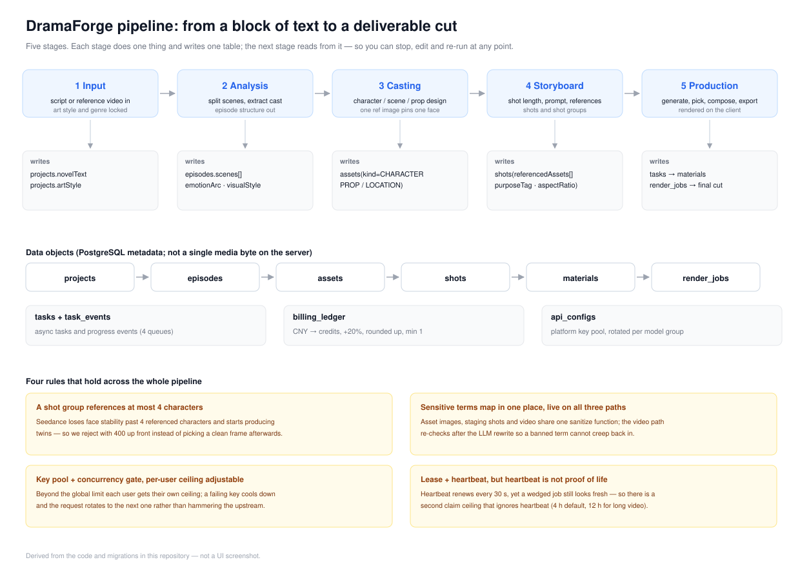
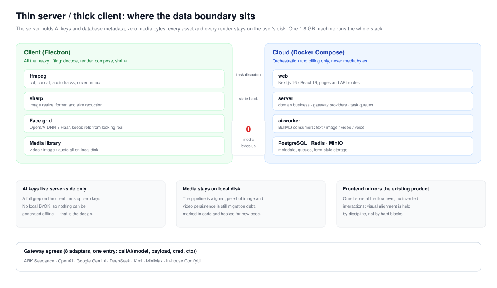
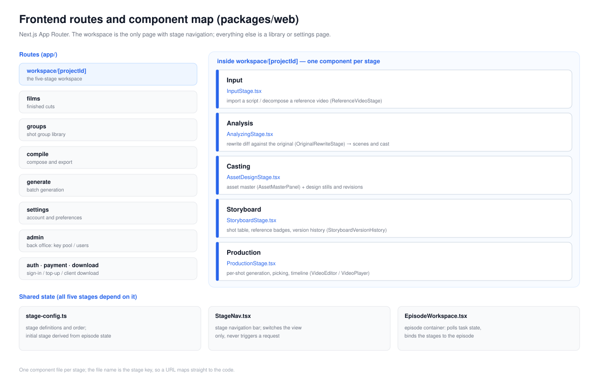

# DramaForge — AI Short-Drama Generation Platform

[中文](README.md) · **English** · [日本語](README.ja.md)

Turn a novel or a script into a finished short drama: broken into shots, illustrated, animated, and voiced. The server handles prompt assembly, task orchestration, billing and multi-vendor access; media rendering happens locally in an Electron client, and the server never stores a single media byte.

> This repository is a **sanitized public source snapshot**: real hosts, domains and SSH key names have been replaced with placeholders, and no production credentials are included. The original 291-commit history was not exported — this is a single snapshot.

## What it solves

A live-action short-drama season is 35 episodes and well over a thousand shots. Hand-crafting it is not viable, and gluing a few scripts together does not produce anything watchable. This platform engineers the middle of that pipeline — four things that have to be solved or there is no deliverable:

| Bottleneck | What happens without it | How it is handled here |
|---|---|---|
| **State across a thousand shots** | Nobody remembers which shot's prompt changed or which episode was re-run; one edit forces a full restart | Five stages, each persisting to its own table and reading only the previous stage's output; any step can be re-run in isolation |
| **Characters drift across shots** | The same person has two different faces in episode 1 and episode 30, and the audience notices immediately | Casting lock: one reference image pins one character; re-rolls create a new revision instead of overwriting; shots reference asset IDs, not names |
| **Video models are unstable** | One rate limit among hundreds of tasks fails the whole batch, with the compute and the waiting on the client | Key pool rotation, failure cooldown, task lease + heartbeat, resumable runs; liveness is judged by a hard claim ceiling, not by the heartbeat |
| **Client footage cannot go to the cloud** | Private source media on the server drives storage cost, egress and compliance risk up together | Thin server: the server holds only AI keys and database metadata; every media byte stays on the client's disk |

The result: a 35-episode, 1,246-shot, 71-asset drama goes from raw text to a finished cut as a repeatable pipeline instead of a one-off manual sprint.



---

## Business flow

The whole product is a five-stage pipeline. Each stage does exactly one thing and writes its result into one table; the next stage reads from that table. Any step can therefore be paused, edited and resumed without starting over.

| Stage | What the UI does | What it writes |
|---|---|---|
| **1 Input** | Import the novel or script text; or drop in a reference video and let the system first extract characters, sets and shot structure | `projects.novelText`, `projects.artStyle`, `projects.artStylePrompt` |
| **2 Script analysis** | Split into episodes, extract scenes and characters, derive an emotion arc; show the rewrite side by side with the source for paragraph-level review | `episodes.scenes[]` (`scene_id`/`characters[]`/`visual_style`), `episodes.emotionArc` |
| **3 Asset design** | Lock the look of every character, prop and location — one reference image per person; regenerating keeps a new revision and never drops the old one | `assets` (`kind` = `CHARACTER`/`PROP`/`LOCATION`), `asset_image_revisions` |
| **4 Storyboard** | One row per shot: duration, prompt, purpose tag, position on the emotion arc, montage type, audio type, and which assets it references | `shots` (`referencedAssets`, `purposeTag`, `aspectRatio` defaulting to 9:16) |
| **5 Production** | Generate candidate material shot by shot → pick takes → composite → export. Batch rendering is a long job that survives closing the page | `tasks`, `tasks_events`, `materials`, `render_jobs` |

Three libraries sit on top of the same data: the **film library** (finished outputs across projects), the **shot-group library** (shot groups that rendered end to end, grouped by project → episode), and the **media library** (video/image/audio kept on the client).

### Data objects

| Table | Contents |
|---|---|
| `projects` | Project level: source text, script JSON, locked art style, version (optimistic lock) |
| `episodes` | Episodes: body text, word count, status, `scenes[]`, emotion arc, default visual style |
| `assets` | Assets: kind, name, description, reference image, metadata, version |
| `shots` | Shots: sequence, duration, prompt, purpose/emotion/montage, referenced assets, selected material, generation status |
| `materials` | Candidate outputs of one generation run, for take selection |
| `tasks` / `tasks_events` | Async tasks and their progress events (text / image / video / voice queues) |
| `render_jobs` | Render jobs, with lease and heartbeat |
| `billing_ledger` | Billing ledger: yuan → credits (20% markup, round up, minimum 1 credit) |
| `api_configs` | Platform key pool, rotated per model group |

### Four rules that hold across the whole pipeline

1. **A shot group may reference at most 4 characters.** Volcano's Seedance docs note that identity stability drops above four reference people and twin/multi-subject artifacts appear; exceeding it is rejected with a 400 up front rather than fixed by re-rolling.
2. **Sensitive terms are mapped in exactly one place and take effect on all three paths.** Asset images, scene blocking images and video generation share one `sanitizePromptForModeration()`; the video path runs an additional idempotent pass after the LLM rewrite, so a term cannot sneak back in.
3. **Key pool plus a concurrency gate.** Beyond the global limit, users get their own allowance; a failing key enters cooldown and the request moves to another key instead of hammering the upstream.
4. **Render jobs use lease + heartbeat — but a heartbeat is not proof of liveness.** Heartbeats renew every 30 seconds and `reapStale` collects the expired; a wedged job still looks "freshly heartbeating", so there is also a claim ceiling that ignores heartbeats.

---

## Architecture



**Thin server, thick client**: the server holds only AI keys and database metadata; every asset and every finished file lives on the user's disk. That is what lets a single 1.8 GB machine run the entire service.

## Frontend structure



| Route | What it is |
|---|---|
| `/workspace/[projectId]` | The main workbench. One component per stage; `stage-config.ts` defines the order and derives the entry stage from episode status |
| `/films` | Film library: finished outputs across projects |
| `/groups` | Shot-group library: groups that rendered end to end, grouped by project → episode |
| `/compile` | Compositing page: takes a list of clip URLs and dispatches a `FILM_EXPORT` render job |
| `/generate` | Experiment page: generate a video straight from a single prompt |
| `/settings` `/admin` | Account preferences / back office (key pool, users) |
| `/auth` `/payment` `/download` | Sign-in, top-up, client download |

Components are named one file per stage (`InputStage.tsx`, `AnalyzingStage.tsx`, …); the file name *is* the stage key, so a URL leads straight to the code.

## Technical highlights

### Four-layer prompt assembly

`domain/prompt/` is split by responsibility: asset prompts (character/set/prop), scene prompts, shot prompts, and whole-group previews. Each layer only builds its own segment; `asset-helpers.ts` ties them together.

### Moderation handled before the request leaves

All three submitted paths (asset images, scene blocking images, Seedance video) pass the same sanitization table before dispatch:

```ts
// packages/server/src/domain/prompt/asset-helpers.ts
export const PROMPT_SANITIZATION_MAP: Array<[string, string]> = [
  ['血迹', '污渍'], ['尸体', '倒地身躯'], ['灵堂', '旧堂'], …
];
export function sanitizePromptForModeration(prompt: string) { … }
```

Adding one term is a single row, and all three paths pick it up.

### Getting around real-person detection

Volcano's Seedance rejects an entire group when a reference image *looks* like a real person (`InputImageSensitiveContentDetected.PrivacyInformation`). The workaround lives on the client:

1. `gen_face_grid.py` locates faces twice — OpenCV DNN (`res10_300x300_ssd_iter_140000`) plus a Haar cascade — and expands each box by 15%;
2. a sparse white grid is drawn only inside the boxes and blended with the original; with no face it degrades to a full-frame grid;
3. `grid-overlay.ts` uses sharp to keep size and bytes sane: jpeg/png/webp, edges 300–6000 px, longest edge capped at 1280 px, JPEG q88, under 30 MB per image;
4. with no Python or offline, it degrades to a full-frame grid or passes the image through untouched rather than blocking generation.

### Multi-vendor gateway and key pool

A single entry point, `callAI(model, payload, cred, ctx)`, fans out to eight provider adapters. The traps are documented in the `gateway/` comments: providers disagree on what `image_url` accepts, Gemini names its safety field differently, and some models have no negative prompt.

`api-key-pool.ts` handles key rotation, cooldown after failure and concurrency spreading; `task/queues.ts` splits BullMQ into four queues: text / image / video / voice.

### Task resilience

Video rendering is a long job, so `render-job-repo.ts` uses a lease-plus-heartbeat model:

- a heartbeat renews the lease every 30 seconds, and `reapStale` reclaims expired ones;
- but the heartbeat runs independently of execution, so **a wedged job keeps looking "freshly heartbeating"** — hence a claim ceiling that ignores heartbeats: 4 hours by default, 12 hours for `LONG_VIDEO_REWRITE`;
- the deciding logic is a pure function with unit tests, and intervention goes through an admin endpoint rather than raw SQL.

## Layout

```
packages/
  server/       Server: domain (business) / gateway (vendors) / task (queues) / ai-worker
  web/          Next.js frontend and API routes
  client/       Electron client: ffmpeg rendering, face grid, media library
  client-live/  Thin shell for the live client
  local-server/ Client-side local Fastify service
  shared/       Shared types and calculations (pricing, durations)
  e2e/          End-to-end tests
docs/           Architecture, operations, incident reviews; assets/ holds the diagrams used above
scripts/        Deploy, rollback, diagnostics, client release
```

## Stack

| Layer | Choice |
|---|---|
| Frontend | Next.js 16 · React 19 · Tailwind 4 · Radix UI |
| Server | Node.js · TypeScript 5.6 · zod · NextAuth |
| Storage | PostgreSQL 16 · Redis · MinIO |
| Queue | BullMQ |
| Client | Electron 43 · ffmpeg · sharp |
| Local server | Fastify 5 · better-sqlite3 |
| AI | ARK Seedance · OpenAI · Gemini · DeepSeek · Kimi · MiniMax · ComfyUI |
| Tests | Vitest (946 server unit tests) |

## Quick start

```bash
pnpm install
cp .env.example .env          # fill in database credentials and AI keys
docker compose up -d postgres redis minio
pnpm -r build
docker compose up -d web ai-worker
```

Local development:

```bash
pnpm --filter '@dramaforge/web' dev
pnpm --filter '@dramaforge/server' dev
```

## Notes

- This is a **source snapshot of the server and client**; it contains no model weights, no build artifacts and no real credentials.
- The DNN model under `packages/client/resources/face-models/` is OpenCV's official face-detection model.
- `YOUR_SERVER`, `your-domain.example.com` and `deploy_key` in the deploy scripts are placeholders — replace them and the scripts work.
- `docs/assets/*.svg` are derived from the code and migrations in this repository and are **not UI screenshots**: the repo ships no runnable frontend build, so real screenshots require bringing the full stack up via "Quick start".
- Production access details are not in this repository and must never be committed to a public one.
