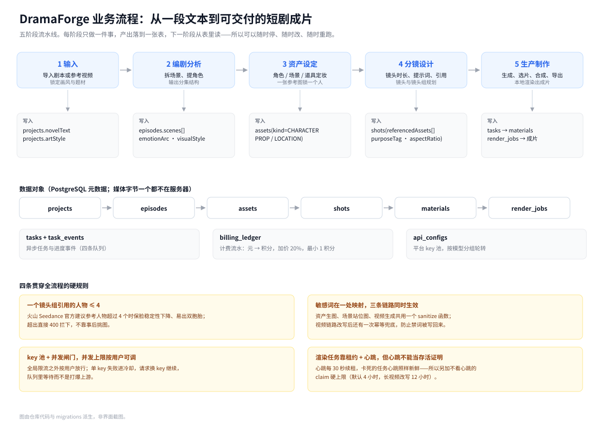
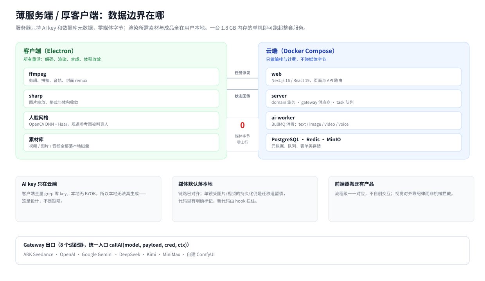
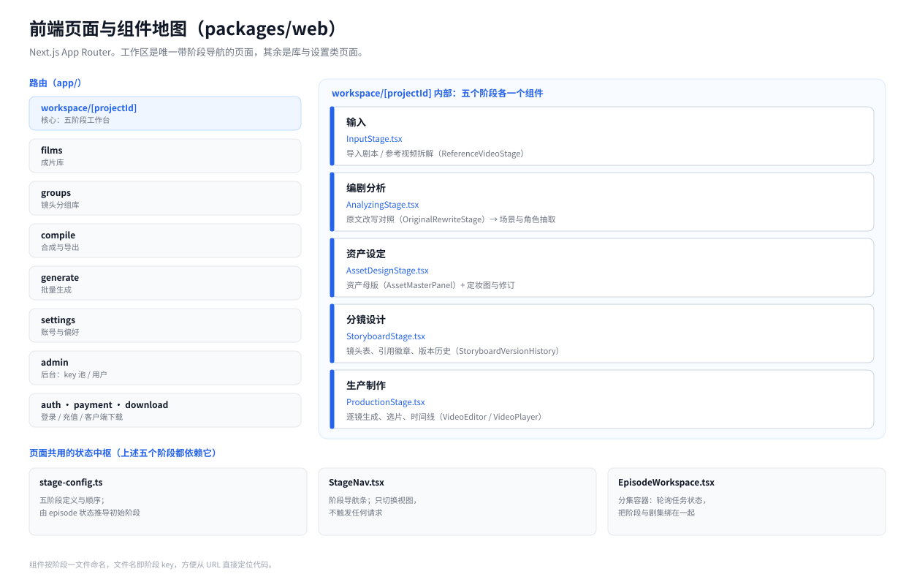

# DramaForge — AI 短剧自动生成平台

[English](README.md) · **中文** · [日本語](README.ja.md)

把一段小说或剧本变成可分镜、可出图、可生成视频、可配音的短剧成片。服务端负责提示词组装、任务编排、计费与多供应商接入；媒体渲染放在 Electron 客户端本地完成，服务器不存媒体字节。

> 本仓库为**脱敏后的源码公开版**：真实主机、域名、SSH 密钥名已替换为占位符，生产凭证一律不含。原仓库 291 次提交的历史未导出，此处为单次快照。

## 它解决什么问题

真人短剧一季 35 集、上千个镜头。手工做不可行；纯脚本拼接又出不来能播的片子。这个平台把中间那段工程化了——下面四件事不做就交不了片：

| 卡点 | 不这么做的后果 | 这里的做法 |
|---|---|---|
| **上千个镜头的状态会乱** | 哪个镜头的提示词改过、哪一集重跑过，Excel 和聊天记录都记不住；改动一次就得全推倒重来 | 五个阶段各自落一张表，每阶段只读上一阶段的产物；任何一步都能单独重跑，不牵连其它 |
| **人物跨镜头会变脸** | 同一个人在第 1 集和第 30 集是两张脸，观众一眼出戏 | 资产定妆：一张参考图锁一个人；改图生成新修订而非覆盖；镜头引用资产 ID，不靠人物名字去猜 |
| **视频模型不稳定** | 几百个任务里一个限流就整批失败，算力和等待成本全落在客户端 | key 池轮转 + 失败冷却 + 任务租约心跳 + 断点续跑；卡死判定不看心跳、只看 claim 硬上限 |
| **客户素材不能上云** | 私有原片存服务器，存储成本、出站流量与合规风险一起涨 | 薄服务端：服务器只持 AI key 与数据库元数据，媒体字节全在客户本地磁盘 |

换来的结果：一条 35 集、1246 个镜头、71 个资产的短剧，从输入原文到导出成片是一条可重复执行的流水线，而不是一次性的手工赶工。



---

## 业务流程

整个产品是一条五阶段流水线。每个阶段只做一件事，产出落进一张表，下一阶段从表里读——所以任何一步都可以停下来改、改完接着跑，不用从头再来。

| 阶段 | 界面做什么 | 落库 |
|---|---|---|
| **1 输入** | 导入小说或剧本原文；或者丢一段参考视频进去，让系统先拆出人物、场景与镜头结构再开始 | `projects.novelText`、`projects.artStyle`、`projects.artStylePrompt` |
| **2 编剧分析** | 按分集切分并抽取场景与角色，同时给出情绪弧线；改写稿与原作并排对照，逐段确认没有被改歪 | `episodes.scenes[]`（`scene_id`/`characters[]`/`visual_style`）、`episodes.emotionArc` |
| **3 资产设定** | 角色、道具、场景三类资产逐个定妆，一张参考图锁一个人；改图会生成新修订，旧图不丢 | `assets`（`kind` = `CHARACTER`/`PROP`/`LOCATION`）、`asset_image_revisions` |
| **4 分镜设计** | 每个镜头一行：时长、提示词、目的标签、情绪弧线位置、蒙太奇类型、音频类型，以及引用了哪些资产 | `shots`（`referencedAssets`、`purposeTag`、`aspectRatio` 默认 9:16） |
| **5 生产制作** | 逐镜生成候选素材 → 选片 → 合成 → 导出成片。整组渲染是长任务，中途可以关页面 | `tasks`、`tasks_events`、`materials`、`render_jobs` |

流程之外还有三个库，用的是同一份数据：**成片库**（跨项目的成品集合）、**镜头组库**（整组已生成成功的镜头组，按项目 → 分集归拢）、**素材库**（客户端的本地视频/图片/音频）。

### 数据对象

| 表 | 存什么 |
|---|---|
| `projects` | 项目级信息：原文、剧本 JSON、画风锁定、版本号（乐观锁） |
| `episodes` | 分集：正文、字数、状态、`scenes[]`、情绪弧线、默认视觉风格 |
| `assets` | 资产：类型、名称、描述、参考图、元数据、版本 |
| `shots` | 镜头：序号、时长、提示词、目的/情绪位/蒙太奇、引用资产、当前选中素材、生成状态 |
| `materials` | 一次生成产出的候选素材，供选片 |
| `tasks` / `tasks_events` | 异步任务与其进度事件（text / image / video / voice 四条队列） |
| `render_jobs` | 渲染任务，带租约与心跳 |
| `billing_ledger` | 计费流水：元 → 积分（加价 20%，向上取整，最小 1 积分） |
| `api_configs` | 平台侧 key 池，按模型分组轮转 |

### 四条贯穿全流程的硬规则

1. **一个镜头组引用的人物 ≤ 4。** 火山 Seedance 官方建议参考人物超过 4 个时保脸稳定性下降、容易出双胞胎；超了直接 400 拦下，不靠事后挑图。
2. **敏感词只在一处映射，三条链路同时生效。** 资产生图、场景站位图、视频生成共用一个 `sanitizePromptForModeration()`；视频链路在大模型改写之后还有一次幂等兜底，防止禁词被改回原文。
3. **key 池 + 并发闸门。** 全局并发之外按用户放行；单个 key 失败进冷却、请求换 key 继续，队列里等待而不是打爆上游。
4. **渲染任务靠租约 + 心跳，但心跳不能当存活证明。** 心跳每 30 秒续租，`reapStale` 回收超时的；可卡死的任务心跳照样新鲜，所以另加一条不看心跳的 claim 硬上限。

---

## 架构



**薄服务端、厚客户端**：服务器只持有 AI key 与数据库元数据，渲染所需素材和成品都在用户本地磁盘。这样一台 1.8 GB 内存的单机就能跑起整套服务。

## 前端结构



| 路由 | 是什么 |
|---|---|
| `/workspace/[projectId]` | 主工作台。五阶段各一个组件，`stage-config.ts` 定义顺序，由分集状态推导进入哪个阶段 |
| `/films` | 成片库：跨项目的成品集合 |
| `/groups` | 镜头组库：整组已生成成功的镜头组，按项目 → 分集归拢 |
| `/compile` | 合片页：给一串 clip 地址，派发 `FILM_EXPORT` 渲染任务 |
| `/generate` | 单条 prompt 直接生成视频的实验页 |
| `/settings` `/admin` | 账号偏好 / 后台（key 池、用户） |
| `/auth` `/payment` `/download` | 登录、充值、客户端下载 |

组件按阶段一文件命名（`InputStage.tsx`、`AnalyzingStage.tsx`…），文件名即阶段 key，从 URL 能直接定位到代码。

## 关键技术点

### 分镜提示词的四层组装

`domain/prompt/` 下按职责拆成四层：资产提示词（角色/场景/道具）、场景提示词、分镜提示词、整组预览。每层只做自己那一段的拼接，最后由 `asset-helpers.ts` 统一收口。

### 内容合规的前置拦截

平台送审的三条链路（资产生图、场景站位图、Seedance 视频）在发包前都过同一张敏感词映射表：

```ts
// packages/server/src/domain/prompt/asset-helpers.ts
export const PROMPT_SANITIZATION_MAP: Array<[string, string]> = [
  ['血迹', '污渍'], ['尸体', '倒地身躯'], ['灵堂', '旧堂'], …
];
export function sanitizePromptForModeration(prompt: string) { … }
```

新增一个禁词只需在表里加一行，三条链路同时生效。

### 真人检测规避

火山 Seedance 对「参考图疑似真人」的输入会整组拒出（`InputImageSensitiveContentDetected.PrivacyInformation`）。处理链路在客户端：

1. `gen_face_grid.py` 用 OpenCV DNN（`res10_300x300_ssd_iter_140000`）+ Haar 级联双路定位人脸框，外扩 15%；
2. 仅在框内绘制稀疏白色网格并与原图混合，无脸时退化为全图网格；
3. `grid-overlay.ts` 用 sharp 负责尺寸与体积收敛：支持 jpeg/png/webp，边长生 300–6000 px，最大边压到 1280 px，JPEG q88，单张 <30 MB；
4. Python 环境缺失或离线时自动降级为全图网格或直接透传，不阻断出图。

### 多供应商 Gateway 与 Key 池

统一的 `callAI(model, payload, cred, ctx)` 入口，下挂 8 个 provider 适配器。单文件最容易踩的几个坑都写在 `gateway/` 的注释里：各家对 `image_url` 的接受形态不同、Gemini 的 safety 字段命名不同、部分模型不支持 negative prompt。

`api-key-pool.ts` 做 key 轮转、失败冷却与并发分摊；上层 `task/queues.ts` 用 BullMQ 分出 text / image / video / voice 四条队列。

### 任务容灾

视频渲染是长任务，`render-job-repo.ts` 用「租约 + 心跳」模型：

- 心跳每 30 秒续租，`reapStale` 回收超时未续租的任务；
- 但心跳独立于执行，**卡死的任务会永远显示「心跳新鲜」**，所以又加了不看心跳的 claim 硬上限：默认 4 小时，`LONG_VIDEO_REWRITE` 单独放宽到 12 小时；
- 判别逻辑抽成纯函数并配单测，止血走 admin 接口而不是裸 SQL。

## 目录结构

```
packages/
  server/       服务端：domain（业务）/ gateway（供应商）/ task（队列）/ ai-worker
  web/          Next.js 前端与 API 路由
  client/       Electron 客户端：ffmpeg 渲染、人脸网格、素材库
  client-live/  直播客户端瘦壳
  local-server/ 客户端本地 Fastify 服务
  shared/       共享类型与计算（定价、时长等）
  e2e/          端到端测试
docs/           架构、运维、故障复盘；assets/ 下为本文引用的结构图
scripts/        部署、回滚、诊断、客户端发版
```

## 技术栈

| 层 | 选型 |
|---|---|
| 前端 | Next.js 16 · React 19 · Tailwind 4 · Radix UI |
| 服务端 | Node.js · TypeScript 5.6 · zod · NextAuth |
| 存储 | PostgreSQL 16 · Redis · MinIO |
| 队列 | BullMQ |
| 客户端 | Electron 43 · ffmpeg · sharp |
| 本地服务 | Fastify 5 · better-sqlite3 |
| AI | ARK Seedance · OpenAI · Gemini · DeepSeek · Kimi · MiniMax · ComfyUI |
| 测试 | Vitest（服务端 946 个单测） |

## 快速开始

```bash
pnpm install
cp .env.example .env          # 填入数据库口令、AI key
docker compose up -d postgres redis minio
pnpm -r build
docker compose up -d web ai-worker
```

本地开发：

```bash
pnpm --filter '@dramaforge/web' dev
pnpm --filter '@dramaforge/server' dev
```

## 说明

- 本仓库是**服务端 + 客户端源码快照**，不含模型权重、不含构建产物、不含任何真实凭证。
- `packages/client/resources/face-models/` 内的 DNN 模型为 OpenCV 官方发布的人脸检测模型。
- 部署脚本中的 `YOUR_SERVER` / `your-domain.example.com` / `deploy_key` 均为占位符，替换后可用。
- `docs/assets/*.svg` 由仓库代码与 migrations 派生绘制，**不是界面截图**：本仓库不含可运行的前端构建，真机截图需按「快速开始」把整套服务跑起来。（本页图内文字为中文，文件名带 `.zh`；英文版为同名 `*.svg`。）
- 生产环境的真实接入信息不在本仓库，也不应提交到任何公开仓库。
